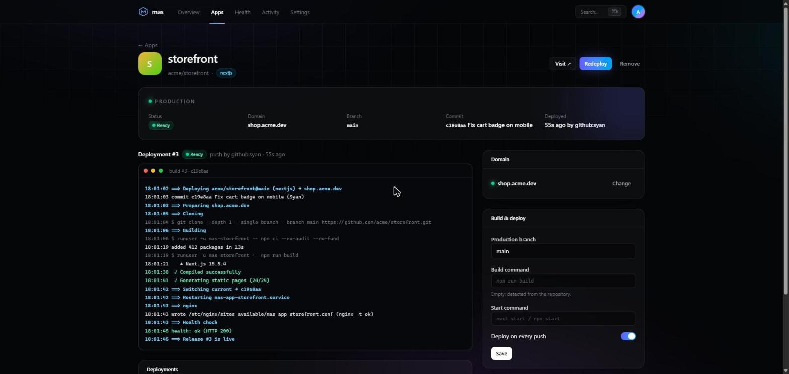
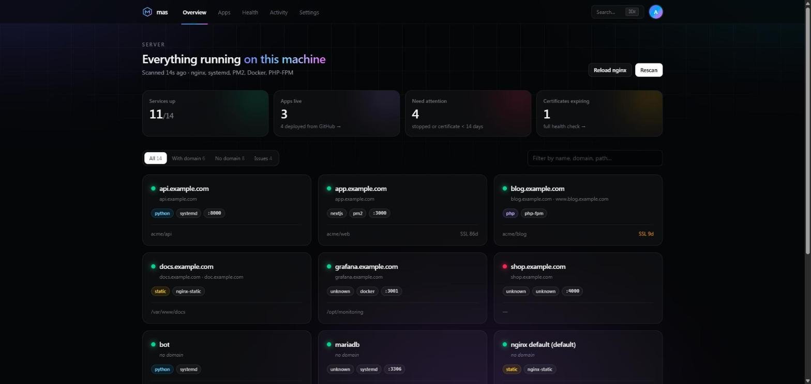

<div align="center">

[English](README.md) · **Français** · [Español](README.es.md) · [Deutsch](README.de.md)

# Mas

**Votre serveur, cartographié et déployé.**
Un tableau de bord auto-hébergé qui adopte ce qui tourne déjà sur votre machine Debian + nginx, déploie depuis GitHub à chaque push,
fait tourner des services prêts à l'emploi et répartit vos apps sur plusieurs serveurs.




</div>

**Mas cartographie le serveur que vous avez déjà.** Pointez-le vers une machine Debian + nginx qui
tourne depuis des années, avec un mélange de sites PHP, d'apps Node sous PM2, quelques unités systemd et
un ou deux conteneurs Docker : il vous dit ce qui tourne, où, pour quel domaine, sous
quel utilisateur et depuis quel dépôt git. Rien n'est réinstallé ni cassé.

Vous gérez ensuite ces services depuis la CLI `mas` ou depuis un tableau de bord web protégé par un
mot de passe et une authentification à deux facteurs, vous surveillez les certificats et nginx, vous reliez
les domaines de votre registrar (OVH, Cloudflare, Gandi, Hetzner, DigitalOcean, Porkbun) et vous déployez
des projets depuis GitHub à chaque push, à la manière de Vercel, sur la même machine. Quand un serveur ne
suffit plus, d'autres serveurs rejoignent le premier comme agents et font tourner des copies de vos apps derrière le même répartiteur de charge.

## En bref

| | |
|---|---|
| 🔎 **Découverte** | vhosts nginx, ports, `/proc`, systemd, PM2 et Docker lus et réunis en une seule liste de services : domaine, utilisateur, dossier, dépôt git. En lecture seule, sans IA. |
| 🚀 **Déploiement depuis GitHub** | Releases atomiques à chaque push, unité systemd et vhost nginx générés, Let's Encrypt, vérification de santé, retour arrière automatique, journaux de build en direct. |
| 🌐 **Domaines** | Enregistrements DNS créés chez OVH, Cloudflare, Gandi, Hetzner, DigitalOcean ou Porkbun, puis HTTPS. |
| 🗄️ **Supabase** | La stack officielle auto-hébergée en un clic, les apps connectées depuis leur dépôt, les migrations au déploiement. |
| 📦 **Services prêts à l'emploi** | Serveur mail, Minecraft, Uptime Kuma, Vaultwarden, n8n, Gitea ou n'importe quelle image Docker, avec sauvegardes chaque nuit. |
| ✏️ **CMS** | Vos clients modifient les textes, les images et les articles de leur site ; chaque enregistrement est un commit et un déploiement. |
| 📊 **Trafic** | Requêtes, pages vues et visiteurs par jour pour chaque site, à partir des journaux nginx, sans cookies. |
| 🧠 **Ressources** | Mémoire et CPU de tout ce qui tourne sur une seule page ; limites mémoire, mise en veille en cas d'inactivité, instances qui suivent le trafic, conseils appliqués en un clic. |
| 🛠️ **Exploitation** | Vérifications de santé avec corrections, redémarrage de tous les services à l'identique, pages de maintenance, tout redéployer. |
| 🖧 **Cluster** | Agents sans tableau de bord, copies des apps sur plusieurs serveurs, carte en direct, bascule automatique, promotion. |

## Sommaire

- [Pourquoi un de plus ?](#pourquoi-un-de-plus-) · [Installation](#installation) · [CLI](#cli) · [Tableau de bord](#tableau-de-bord)
- [Déployer depuis GitHub](#déployer-depuis-github) · [Domaines](#domaines-ovh-cloudflare-gandi-hetzner-digitalocean-porkbun) ·
  [Supabase](#supabase-auto-hébergé) · [Services prêts à l'emploi](#services-prêts-à-lemploi) · [CMS](#un-cms-pour-vos-clients)
- [Exploiter le serveur](#exploiter-le-serveur) : [ressources](#ressources), [trafic](#statistiques-de-trafic),
  [maintenance](#mode-maintenance), [tout redémarrer](#tout-redémarrer-à-lidentique), [vérifications de santé](#vérifications-de-santé)
- [Plusieurs serveurs](#plusieurs-serveurs-cluster) · [Fonctionnement de la détection](#fonctionnement-de-la-détection) ·
  [Modèle de sécurité](#modèle-de-sécurité) · [Développement](#développement) · [Feuille de route](#feuille-de-route)

> [!WARNING]
> **Bêta.** Mas tourne en root et modifie nginx, systemd et le DNS. Chaque modification est sauvegardée et
> validée (`nginx -t`) et la découverte est en lecture seule, mais essayez-le d'abord sur un serveur que vous
> pouvez restaurer, et lisez le [modèle de sécurité](#modèle-de-sécurité). Vos retours et vos issues sont les bienvenus.

## Pourquoi un de plus ?

Coolify, Dokploy et CapRover sont excellents, mais ils veulent un serveur vierge : tout doit
tourner dans leurs conteneurs, derrière leur proxy. Si votre serveur héberge déjà dix sites
configurés à la main, adopter l'un d'eux revient à tout migrer.

Mas part de l'autre bout :

|                         | Coolify / Dokploy / CapRover | Mas                                   |
|-------------------------|------------------------------|---------------------------------------|
| Point de départ         | Serveur neuf                 | Votre serveur existant                |
| Reverse proxy           | Traefik / Caddy (le leur)    | Votre nginx, vos vhosts               |
| Environnements d'exécution | Docker uniquement         | PHP-FPM, systemd, PM2, Docker, statique |
| Apps existantes         | À redéployer                 | Détectées et adoptées sur place       |
| Détection               | n/a                          | Analyse déterministe, sans IA         |
| Apps inactives          | Toujours en marche           | Peuvent se mettre en veille et se réveiller à la visite suivante |

Chaque détection est déterministe : analyse des fichiers de configuration, `/proc`, `ss`, `systemctl`, `pm2 jlist`
et le socket Docker. Aucun modèle d'IA n'intervient nulle part, et la découverte n'a besoin d'aucune API externe
(seules les intégrations facultatives avec GitHub et les fournisseurs DNS parlent à leurs propres API).

## Installation

Sur le serveur (Debian 12+, en root) :

```console
$ git clone https://github.com/SyanCode/Mas.git /opt/mas-install
$ cd /opt/mas-install
$ sudo ./deploy/install.sh --domain mas.example.com --email you@example.com
```

Sans `--domain`, le tableau de bord reste privé (tunnel SSH, voir plus bas). Mises à jour :
`sudo mas self-update` (git pull, réinstallation, rebuild, redémarrage).

L'installateur est idempotent et demande deux choses :

1. **Le mot de passe administrateur, puis la 2FA** : un QR code s'affiche dans le terminal ; scannez-le avec
   Google Authenticator, Aegis, 1Password, Bitwarden… et saisissez le code à 6 chiffres.
2. **Le domaine du tableau de bord** (par ex. `mas.example.com`, son DNS doit pointer vers le serveur). Mas obtient
   un certificat Let's Encrypt et installe un vhost HTTPS. Laissez-le vide pour garder le tableau de bord
   privé et y accéder par un tunnel SSH :
   `ssh -L 7070:127.0.0.1:7070 you@server`, puis ouvrez http://localhost:7070.

En mode non interactif : `sudo ./deploy/install.sh --domain mas.example.com --email you@example.com`.

Ce qui est installé : `/opt/mas/src` (sources), `/opt/mas/venv`, `/etc/mas/config.toml`,
`/var/lib/mas/mas.db`, `mas.service`, `/etc/nginx/sites-available/mas.conf` et `/usr/local/bin/mas`.

### Mise à jour

```console
$ sudo mas self-update                       # follow the published branch (git checkout)
$ sudo mas self-update --from mas.tar.gz     # from a `git archive` tarball
```

La commande met à jour les sources, réinstalle, reconstruit le tableau de bord et redémarre `mas.service`. Un checkout
git est placé sur `origin/<branch>` même si cette branche a été force-pushée ; elle refuse de toucher à un
checkout qui a des modifications locales. Une installation depuis une archive garde les sources précédentes dans
`/opt/mas/src.mas-bak-<date>`.

Quand une nouvelle version est publiée, chaque commande `sudo mas …` commence par une ligne qui rappelle de
lancer `sudo mas self-update` (vérifié auprès de GitHub au plus toutes les 6 heures, délai de 2 s, silencieux
hors ligne ; `MAS_NO_UPDATE_CHECK=1` le désactive).

## CLI

```console
$ sudo mas scan                 # table of every detected service (--json available)
$ sudo mas logs blog.example.com -n 200
$ sudo mas restart api          # asks for confirmation (-y to skip)
$ sudo mas start|stop|reload <service>
$ sudo mas nginx reload         # nginx -t first, reload only if valid
$ sudo mas history              # who did what, when, with what result

$ sudo mas user create [name]   # password + 2FA QR code
$ sudo mas user 2fa [name]      # set up / replace the authenticator app
$ sudo mas user 2fa-reset [name]  # lost phone: disable 2FA (root only)
$ sudo mas user passwd [name]
```

`<service>` est l'identifiant affiché par `mas scan` (en général le domaine), ou toute partie non ambiguë de celui-ci.

| Gestionnaire   | Actions                        | Commande                                          |
|----------------|--------------------------------|---------------------------------------------------|
| `systemd`      | start, stop, restart, reload   | `systemctl <action> <unit>`                       |
| `pm2`          | start, stop, restart, reload   | `runuser -u <owner> -- pm2 <action> <app>`        |
| `docker`       | start, stop, restart           | API Docker `POST /containers/<id>/<action>`       |
| `php-fpm`      | reload, restart                | `systemctl <action> php*-fpm.service`             |
| `nginx-static` | reload                         | `nginx -t && systemctl reload nginx`              |

## Tableau de bord



Appuyez sur <kbd>⌘K</kbd> / <kbd>Ctrl</kbd>+<kbd>K</kbd> n'importe où pour aller à un service, une app ou une page.

Le tableau de bord parle **anglais, français, espagnol et allemand** : la langue du navigateur est utilisée par
défaut, et le sélecteur du menu utilisateur (et de la page de connexion) retient votre choix. Le
texte anglais sert de clé (`t("Deploy Supabase")`), les traductions se trouvent dans `web/locales/<lang>.json`,
et `tests/test_i18n.py` échoue si un texte n'a pas de traduction. Ajouter une langue, c'est un fichier JSON
plus une ligne dans `web/lib/i18n.tsx`.

| Page | Ce qu'elle affiche |
|---|---|
| **Vue d'ensemble** | chaque service détecté : état, domaines, type, gestionnaire, port, expiration SSL (en orange sous 14 jours), dépôt GitHub, l'app Mas à laquelle il appartient ; filtres et recherche ; **Tout redémarrer**, **Recharger nginx** |
| **Service** | détails, mémoire / CPU / uptime / ports et liens en direct, journaux, actions (avec confirmation), trafic de son site, historique, nom affiché et notes, **Remplacer par une app Mas** |
| **Apps** | les apps déployées depuis GitHub et les services du catalogue ; **Tout redéployer**, **Maintenance** |
| **App** | déploiements avec journaux de build en direct, retour arrière, domaine, trafic, ressources, répartition de charge, maintenance, base de données, CMS, variables d'environnement |
| **Bases de données** | le Supabase auto-hébergé : composants, mémoire par conteneur, accès à Studio, sauvegardes |
| **Ressources** | mémoire et CPU de tout ce qui tourne sur le serveur, limites, veille, instances, conseils |
| **Serveurs** | le cluster : ce serveur, les autres, jetons d'adhésion, carte en direct des requêtes |
| **Santé** | vérifications des certificats, de certbot, de nginx et du DNS, avec les corrections |
| **Activité** | le journal d'audit : qui a fait quoi, quand, avec quel résultat |
| **Paramètres** | 2FA, mot de passe, GitHub App, fournisseurs DNS, personnes (éditeurs CMS et invitations) |

Thème clair et sombre (suit le système par défaut).

## Déployer depuis GitHub

### 1. Connecter GitHub (une fois)

Dans **Paramètres → GitHub**, cliquez sur **Créer la GitHub App** (éventuellement pour une organisation). GitHub
affiche l'App à créer ; confirmez, et GitHub renvoie ses identifiants à Mas grâce au
[manifest flow](https://docs.github.com/en/apps/sharing-github-apps/registering-a-github-app-from-a-manifest) :
App ID, clé privée (stockée dans `/etc/mas/github-app.pem`, `0600`) et secret du webhook (stocké dans
`/etc/mas/config.toml`, `0600`). Cliquez ensuite sur **Installer** et choisissez les dépôts que Mas peut lire.

L'App est privée et demande : **Contents : lecture et écriture** (l'écriture ne sert qu'au CMS, pour
commiter les modifications de contenu), **Metadata : lecture**, **Pull requests : lecture**, ainsi que les événements de webhook **push** et
**pull_request**. Une App créée avant le CMS a Contents en lecture seule : passez-le
à *Read and write* dans les paramètres de l'App sur GitHub, puis acceptez les nouvelles permissions sur
l'installation.

<details>
<summary>Créer l'App à la main</summary>

1. github.com → Settings → Developer settings → GitHub Apps → **New GitHub App**.
2. Homepage URL : `https://<your dashboard>` ; Webhook URL : `https://<your dashboard>/api/github/webhook` ;
   Webhook secret : une longue chaîne aléatoire.
3. Permissions : Contents en lecture et écriture, Metadata en lecture seule, Pull requests en lecture seule. Événements : Push, Pull request.
4. « Only on this account », créez, puis **Generate a private key** (télécharge un `.pem`).
5. Sur le serveur : `sudo mas github setup` (demande l'App ID, le slug, le chemin du `.pem` et le secret), puis
   `sudo systemctl restart mas`, et installez l'App sur vos dépôts.
</details>

### 2. Créer une app

**Apps → Nouvelle app** : choisissez un dépôt et une branche. Mas détecte le type (Next.js, Node, Python,
statique, PHP) à partir du dépôt ; indiquez un domaine facultatif et des variables d'environnement (stockées
chiffrées avec une clé dans `/etc/mas/secret.key`). Créez : le premier déploiement démarre et son journal
s'affiche en direct dans le tableau de bord.

Chaque push sur la branche déclenche ensuite un déploiement automatique :

1. `git clone` du commit poussé dans `/srv/mas/apps/<app>/releases/<sha>/` (le jeton d'installation
   est transmis à git par l'environnement, jamais en ligne de commande ni dans les journaux)
2. build sous l'utilisateur dédié `mas-<app>` (`npm ci && npm run build`, un venv Python +
   `pip install`, `composer install`, ou votre propre commande de build)
3. bascule atomique du lien symbolique `current` (une app Next.js construite avec `output: 'export'` n'a pas de
   serveur : Mas sert son dossier `out/` avec nginx et se passe de l'unité systemd)
4. redémarrage de `mas-app-<app>.service` (unité systemd générée, utilisateur non root, `NoNewPrivileges`,
   `ProtectSystem`, `ProtectHome`, app à l'écoute sur `127.0.0.1:<port>`)
5. vhost nginx généré à partir d'un modèle (sauvegarde, `nginx -t`, rechargement ; refusé si un autre vhost
   sert déjà le domaine)
6. `certbot certonly --nginx` si le domaine n'a pas encore de certificat, puis vhost HTTPS
7. vérification de santé HTTP ; **en cas d'échec, la release précédente est remise en place automatiquement**

Les 5 dernières releases sont conservées ; **Revenir** remet n'importe laquelle d'entre elles en place en un clic (`mas rollback <app>`).

### Domaines (OVH, Cloudflare, Gandi, Hetzner, DigitalOcean, Porkbun)

Mas peut créer lui-même les enregistrements DNS. Dans **Paramètres → Domaines** :

1. Indiquez l'**IP publique** de ce serveur (Mas propose l'adresse vers laquelle pointent vos domaines existants).
2. Connectez un ou plusieurs registrars. Chaque carte renvoie vers la page de jetons du fournisseur et liste les
   droits exacts à accorder (lire les zones, créer/modifier des enregistrements ; Mas ne supprime jamais un enregistrement). Les clés sont
   vérifiées auprès du fournisseur, puis stockées chiffrées.

| Fournisseur | Identifiants |
|----------|-------------|
| OVHcloud | application key + secret + consumer key (page de jetons avec les droits pré-remplis) |
| Cloudflare | jeton d'API, modèle « Edit zone DNS » (les enregistrements sont créés en DNS uniquement, nuage gris) |
| Gandi | Personal access token (LiveDNS) |
| Hetzner DNS | jeton d'API |
| DigitalOcean | jeton d'API avec le scope `domain` |
| Porkbun | clé d'API + secret (activez l'accès à l'API sur chaque domaine) |

Namecheap n'est pas pris en charge : son API exige une IP en liste blanche et réécrit toute la zone à chaque modification.

Ensuite, sur une app (ou dans *Nouvelle app*), choisissez l'un de vos domaines et un sous-domaine (le nom de l'app par
défaut). Mas vérifie le nom en direct (libre, pointe déjà ici, pointe ailleurs, CNAME,
déjà utilisé), crée l'enregistrement `A` (et `AAAA`), attend qu'il soit résolu, puis déploie avec le
site nginx et le certificat HTTPS. Un enregistrement qui pointe ailleurs n'est remplacé qu'après une confirmation
explicite ; un CNAME n'est jamais touché.

CLI : `mas dns connect <provider>`, `mas dns ip <ipv4> [--ipv6 …]`, `mas dns zones`,
`mas domain <app> <sub.example.com> [--overwrite | --no-dns]`.

### Supabase auto-hébergé

**Bases de données → Déployer Supabase** installe la stack Docker officielle de Supabase (Postgres, Auth,
REST, Realtime, Storage, Studio) sur le serveur :

- chaque port publié est lié à `127.0.0.1` (sinon Docker contournerait le pare-feu) ;
- seule l'API publique (`/rest`, `/auth`, `/realtime`, `/storage`, `/functions`, `/graphql`) est
  publiée via nginx, sur le domaine de votre choix (enregistrement DNS créé comme pour les apps), en HTTPS ;
- **Studio reste privé** : sur le domaine de Supabase, il ne répond qu'au réseau local et aux
  adresses que vous autorisez (page Bases de données), derrière sa page de connexion ; sinon par le tunnel SSH qu'affiche Mas ;
- les secrets (mot de passe Postgres, secret JWT, clés `anon` / `service_role`) sont générés par Mas et
  stockés chiffrés ;
- un `pg_dump` est lancé chaque jour, les 7 derniers sont gardés dans `/var/lib/mas/backups/supabase`.

Une instance par serveur (toutes les apps connectées partagent sa base de données) ; la stack a besoin de Docker avec
le plugin compose.

**Que faut-il installer ?** Choisissez ce dont vos apps ont besoin, Mas propose le choix adapté à la mémoire libre :

| Choix | Ce que les apps peuvent faire | ≈ RAM |
|---|---|---|
| **Essentiel** | base de données, comptes utilisateurs, API | 400 Mo |
| **Recommandé** | + envoi de fichiers, mises à jour en direct, tableau d'administration | 880 Mo |
| **Complet** | + redimensionnement d'images, fonctions serveur, journaux, beaucoup de connexions | 1,8 Go |

**Personnaliser** affiche les composants un par un, et la page Bases de données permet de les modifier plus tard
(`docker compose up -d --remove-orphans`, les volumes de données sont conservés) :

| Composant | Nom Supabase | Recommandé | ≈ RAM |
|---|---|---|---|
| Base de données, comptes utilisateurs et API (toujours actifs) | Postgres, Auth, REST, Kong | oui | 400 Mo |
| Tableau d'administration (privé, démarré/arrêté à la demande) | Studio + pg-meta | oui | 250 Mo |
| Mises à jour en direct | Realtime | oui | 150 Mo |
| Envoi de fichiers | Storage | oui | 80 Mo |
| Redimensionnement d'images | imgproxy | non | 60 Mo |
| Fonctions serveur | Edge Functions | non | 150 Mo |
| Journaux et statistiques | Logflare + Vector | non | 600 Mo |
| Beaucoup de connexions | Supavisor (désactivé : Postgres est publié directement sur `127.0.0.1`) | non | 150 Mo |

#### Connecter une app

La carte **Base de données** d'une app lit son dépôt et s'y adapte :

- **Elle détecte que l'app utilise Supabase** à partir de ses bibliothèques (`@supabase/supabase-js`,
  `@supabase/ssr`, `supabase` pour Python…), de son fichier d'exemple d'environnement ou d'un dossier `supabase/`. Si le
  serveur n'a pas encore de Supabase, **Créer la base de données et connecter** l'installe et connecte l'app
  dès qu'il tourne. Dans **Apps → Nouvelle app**, une app Supabase est connectée avant son premier build.
- **Connecter la base de données** écrit l'URL et les clés sous les noms que lit le code : les noms habituels
  (`SUPABASE_URL`, `NEXT_PUBLIC_SUPABASE_URL`, `SUPABASE_ANON_KEY`, `SUPABASE_SERVICE_ROLE_KEY`,
  `DATABASE_URL`…), ceux des frameworks (`VITE_…`, `PUBLIC_…` pour Astro et SvelteKit, `EXPO_PUBLIC_…`)
  et toutes les variables Supabase de son `.env.example`. Un secret (clé service_role, URL Postgres) n'est
  jamais écrit dans une variable lisible par le navigateur (`NEXT_PUBLIC_`, `VITE_`…) : Mas le signale à la place.
- **Le dépôt décrit sa base de données** avec l'arborescence de la CLI Supabase :
  `supabase/migrations/<timestamp>_<name>.sql` et `supabase/seed.sql`. À chaque déploiement d'une
  app connectée, Mas exécute les nouvelles migrations avant le build, dans l'ordre, chacune dans une transaction,
  et les enregistre dans `supabase_migrations.schema_migrations` comme le fait `supabase db push`. Si l'une
  échoue, le déploiement s'arrête et le site reste sur sa version actuelle. Le seed n'est chargé qu'une fois,
  si vous cochez la case lors de la connexion. La carte liste les migrations, appliquées ou en attente.
- **Importer ma base de dev** copie le schéma `public` d'un projet supabase.com (tables,
  fonctions, politiques, avec ou sans les lignes) et connecte l'app. Collez la chaîne de connexion *Session pooler*
  (projet → **Connect**) ; elle est transmise à `pg_dump` par l'environnement, jamais
  en ligne de commande, et n'est pas conservée. Les tables qui existent déjà ici sont refusées sauf si vous cochez
  *les remplacer*. Mas utilise un `pg_dump` aussi récent que le serveur source. Ne sont pas copiés : les utilisateurs
  (`auth`), les fichiers (Storage) et les triggers sur `auth.users`.

Une app connectée à un autre projet Supabase (son `SUPABASE_URL` pointe ailleurs) n'est pas touchée.

Les services qui restent sont réglés pour un petit serveur : Postgres avec `shared_buffers=64MB` et une mémoire
de travail réduite, un seul worker Kong avec un cache de 32 Mo, un tas Node.js plafonné pour Studio, Storage et
pg-meta. Le fichier d'origine non modifié est conservé sous le nom `docker-compose.original.yml` ; la page affiche
la mémoire réellement utilisée par chaque conteneur.

Restaurer une sauvegarde : `docker cp <file> supabase-db:/tmp/r.dump && docker exec supabase-db pg_restore
-U postgres -d postgres --clean /tmp/r.dump`.

### Services prêts à l'emploi

**Apps → Déployer un service** fait tourner des serveurs prêts à l'emploi avec Docker, sans dépôt : choisissez-en un, remplissez
un court formulaire, Mas écrit `/srv/mas/stacks/<name>/docker-compose.yml`, ouvre les ports, obtient le
certificat de son adresse et indique comment l'utiliser.

| Service | Ce que vous obtenez |
|---|---|
| **Serveur Minecraft (Java)** | Paper, Vanilla, Fabric, Forge ou Purpur ; version, mémoire, mode de jeu, joueurs autorisés, opérateurs |
| **Serveur Minecraft (Bedrock)** | pour téléphones, consoles et Windows (UDP 19132) |
| **Serveur mail** | docker-mailserver : vos boîtes `@yourdomain` dans n'importe quelle application mail (IMAP 993, SMTP 465/587), clé DKIM créée, les enregistrements DNS à ajouter (A, MX, SPF, DKIM, DMARC) listés avec leurs valeurs, **Ajouter une boîte mail** en un clic |
| **Uptime Kuma**, **Vaultwarden**, **n8n**, **Gitea** | servis sur leur propre domaine en HTTPS |
| **N'importe quelle image Docker** | une image, son port web sur un domaine et/ou des ports publiés tels quels, son environnement et un dossier conservé |

- Les pages web écoutent sur `127.0.0.1` et nginx les sert en HTTPS. Les ports destinés à l'extérieur
  (25565, 25, 993…) sont publiés par Docker sur toutes les interfaces, ce qui les ouvre dans le pare-feu ;
  Mas refuse un port déjà utilisé par un autre service.
- Les mots de passe (première boîte mail, jeton d'administration Vaultwarden) sont générés et conservés chiffrés ; la
  page du service les affiche à la demande, avec l'adresse à laquelle se connecter.
- La page du service propose **Démarrer / Arrêter / Redémarrer**, ses journaux et ses réglages : les enregistrer
  le redéploie. **Redéployer** récupère aussi la dernière image. Les données restent dans `/srv/mas/stacks/<name>/data`
  d'une mise à jour à l'autre ; supprimer le service les conserve, sauf si vous cochez *Supprimer aussi ses données*.
- **Sauvegardes** : chaque nuit entre 3 h et 5 h (heure du serveur), Mas arrête le service, copie son
  dossier `data` dans `/var/lib/mas/backups/stacks/<name>/<name>-<date>.tar.gz` et le redémarre
  (un monde Minecraft ou une boîte mail copiés pendant une écriture ne pourraient pas être restaurés). Les 7 dernières sont gardées
  (`stacks_keep_backups` dans `[deploy]`), et elles survivent au service. **Sauvegarder maintenant** et
  **Restaurer** se trouvent sur la page du service ; une restauration met d'abord les données actuelles de côté dans
  `data.before-restore`.
- Les serveurs Minecraft démarrent avec un tas de 512 Mo qui grandit jusqu'à la mémoire choisie, et la rendent
  quand personne ne joue.
- Pour le mail, demandez à votre hébergeur le DNS inverse (PTR) du serveur et vérifiez qu'il ne
  bloque pas le port 25 sortant.

Un nouveau service, c'est un modèle dans `mas/stacks.py` (un fichier compose construit à partir du formulaire) ; après avoir modifié
le catalogue, lancez `python -m mas.stacks > web/lib/stackTexts.ts` pour que ses textes soient traduits.

### Un CMS pour vos clients

Hébergez les sites de vos clients avec Mas et laissez chacun modifier son propre contenu (textes, images, articles),
sans lui donner accès au serveur ni au code. Le site garde son design : le dépôt
déclare ce qui est modifiable dans **`mas.cms.json`**, le client remplit des formulaires dans le tableau de bord, et Mas
écrit les valeurs, sous forme de commit sur la branche déployée (ce qui redéploie le site) ou, pour les collections
stockées dans Supabase, sous forme de lignes de table en ligne immédiatement.

**→ La référence complète se trouve dans [docs/cms.md](docs/cms.md)** : pages, collections (articles, actualités…),
types de champs, stockage git ou Supabase, comment le site lit son contenu, et une checklist.

```json
{
  "$schema": "https://raw.githubusercontent.com/SyanCode/Mas/main/schema/mas.cms.schema.json",
  "pages": [{ "id": "home", "label": "Home page", "file": "content/home.json",
              "fields": [{ "key": "title", "type": "text", "max": 80, "required": true },
                         { "key": "hero", "type": "image" }] }],
  "collections": [{ "id": "articles", "label": "Articles", "dir": "content/articles",
                    "fields": [{ "key": "title" }, { "key": "date", "type": "date" },
                               { "key": "body", "type": "markdown" }] }]
}
```

**Rendre un site compatible Mas.** Avec Claude Code, installez une fois le plugin de ce dépôt,
puis demandez-le simplement, en langage courant, dans le projet du site :

```
/plugin marketplace add SyanCode/Mas
/plugin install mas-cms@mas

Rends ce site compatible Mas
```

Claude déplace le contenu modifiable dans des fichiers JSON, écrit `mas.cms.json`, branche le site dessus
sans toucher à son design et vérifie le résultat avec le `check.py` du plugin. À la main : suivez la
[checklist](docs/cms.md#making-a-site-compatible-checklist), et commencez `mas.cms.json` par la ligne
`$schema` ci-dessus pour profiter de l'autocomplétion dans votre éditeur. La carte **CMS** d'une app peut aussi écrire
`mas.cms.json` à partir des fichiers JSON déjà présents dans le dépôt.

Dans **Apps → Nouvelle app**, un dépôt avec un `mas.cms.json` valide affiche un badge **Compatible Mas** (ou
*mas.cms.json invalide*, avec la raison au survol). Ensuite :

1. Donnez un compte à votre client, dans **Paramètres → Personnes**, de l'une de ces trois façons :
   - **Lien d'invitation** (le plus simple) : choisissez les sites, envoyez le lien. Il ne sert qu'une fois, pendant 7 jours,
     même quand les inscriptions sont fermées ; le client choisit un nom d'utilisateur et un mot de passe et arrive sur
     son site. Seule une empreinte du lien est stockée, et les liens en attente peuvent être révoqués.
   - **Ouvrir les inscriptions** : n'importe qui peut créer un compte sur `/signup/`, éventuellement seulement avec un
     code d'invitation que vous définissez. Un nouveau compte ne voit rien tant que vous ne lui avez pas attribué de site. Les inscriptions sont
     limitées à 5 par heure et par adresse et inscrites dans le journal d'audit.
   - **Nouvel éditeur** : vous choisissez le nom d'utilisateur, Mas génère un mot de passe affiché une seule fois.

   **Sites**, sur chaque éditeur, choisit les apps qu'il peut modifier ; la page de l'app propose le même interrupteur dans
   sa carte **CMS**, qui vérifie aussi le schéma (et, pour les collections Supabase, crée la table).
2. Le client se connecte au même tableau de bord et ne voit que **Mes sites** et **Compte** (mot de passe,
   2FA). Toutes les autres routes de l'API répondent `403` à un éditeur.

Ce qui protège le site : le schéma est toujours lu depuis le dépôt (jamais depuis le navigateur) ;
seuls les champs déclarés des fichiers (ou tables) déclarés sont écrits, et les clés que le schéma ne
connaît pas restent intactes ; les valeurs sont vérifiées côté serveur (longueur, type, choix autorisés, liens
limités à `https://`, `/`, `#`, `mailto:` et `tel:`, pas de caractères de contrôle) ; `.git/`, `.github/`
et `mas.cms.json` lui-même ne peuvent pas être ciblés ; les images sont vérifiées d'après leur contenu (PNG, JPEG, GIF,
WebP, AVIF ; pas de SVG) et reçoivent un nouveau nom de fichier. Chaque enregistrement est un seul commit (`cms(home): … Edited
by <editor>`) par-dessus la version que l'éditeur a ouverte : si quelqu'un l'a modifiée entre-temps, l'éditeur
est invité à recharger au lieu d'écraser. Annulez une modification avec `git revert` ou revenez au
déploiement précédent dans Mas. Les collections Supabase sont écrites avec la clé service_role, qui ne quitte jamais
Mas ; le site les lit avec sa clé anon (row level security : lecture seule).

### Répartition de charge

La carte **Répartition de charge** d'une app Node.js, Next.js ou Python répartit son trafic :

- **Instances sur ce serveur** : Mas lance l'app N fois (`mas-app-<id>.service`,
  `mas-app-<id>.2.service`…, chacune sur son propre port loopback) pour utiliser tous les cœurs du CPU. Un redéploiement
  les redémarre une par une et vérifie chacune avant de passer à la suivante, si bien que le site n'est jamais coupé ;
  si une instance ne revient pas, la release est annulée.
- **Serveurs du cluster** : des copies construites par Mas sur les agents que vous cochez (voir
  [Plusieurs serveurs](#plusieurs-serveurs-cluster)).
- **Autres serveurs** : `host:port` de copies de l'app que vous faites tourner ailleurs, en général sur un
  réseau privé. Elles sont ajoutées au même pool.

Avec plus d'un backend, le vhost reçoit un `upstream` nginx (`least_conn`) : un backend qui
échoue deux fois est ignoré pendant 10 s, et une requête qui tombe sur un backend en cours de redémarrage ou hors service est renvoyée
vers le suivant. Répartir les requêtes implique que l'app ne garde pas d'état en mémoire ni sur le disque local
(sessions, fichiers envoyés, caches) : utilisez la base de données ou le stockage Supabase. Les sites statiques et PHP sont
servis directement par nginx et n'ont besoin de rien de tout cela.

### Pendant le déploiement d'un site

Lors d'un premier déploiement, le domaine répond immédiatement avec une **page « Déploiement… »** (vhost nginx
provisoire) et obtient son certificat **avant** le build, si bien que les visiteurs ne tombent jamais sur le vhost
d'un autre site (le `421 Misdirected Request` que vous obtiendriez sinon en HTTP/2). Le vrai site la remplace
dès que la vérification de santé réussit ; si le premier déploiement échoue, une page « pas encore disponible » reste en place.
Les apps derrière le proxy affichent aussi cette page pendant la seconde ou deux d'un redémarrage, au lieu d'une erreur 502.

### Remplacer un site détecté par une app

Un site détecté par Mas (un dossier PHP, un site statique, une app PM2…) peut être remplacé par une app Mas construite à partir de
son dépôt, **sans interruption** : l'app est construite et vérifiée à côté de l'ancien site, puis
les anciens fichiers nginx partent et le vhost de l'app arrive dans le même rechargement. Si le premier déploiement
échoue, l'ancien site reste tel quel. La page du service propose **Remplacer par une app Mas** ; supprimer
l'app par la suite remet l'ancien site en place.

### Tout redéployer

**Apps → Tout redéployer** met en file d'attente un déploiement du dernier commit de chaque app venant de GitHub ; ils s'exécutent
l'un après l'autre (les services du catalogue ne sont pas touchés).

### Adopter un service existant

Un service détecté dont le dossier est un checkout GitHub (par exemple une app PM2 ou systemd) affiche
**Connecter à GitHub** sur sa page. Mas le déploie alors **sur place**, sans rien réinstaller :
`git fetch` + `git reset --hard` dans son dossier (sous l'identité du propriétaire du dossier, refusé s'il y a des
modifications locales non commitées), build, redémarrage via son gestionnaire actuel, vérification de santé, et
`git reset` vers le commit précédent en cas d'échec.

### CLI

```console
$ sudo mas apps                    # apps, live release, last deploy
$ sudo mas deploy <app>            # deploy now, logs printed live
$ sudo mas releases <app>
$ sudo mas rollback <app> [release]
$ sudo mas github status
```

Les déploiements de prévisualisation par pull request ne sont pas encore implémentés ; le modèle de données (un `environment`
par app) est prêt pour eux.

## Exploiter le serveur

### Ressources

La page **Ressources** montre ce qui utilise la mémoire et le CPU du serveur, tout à la fois,
actualisé toutes les 10 secondes : une ligne par app Mas (toutes ses instances), par projet compose (services
du catalogue, Supabase, vos propres fichiers compose), par autre service système, pour Mas lui-même et pour les sessions
utilisateur, triées par mémoire, avec le CPU de chacune. Elle lit les cgroups de systemd
(`memory.current` sans le cache de fichiers inactif, `cpu.stat`), si bien que mesurer tout le serveur
ne coûte presque rien.

Chaque app Node.js, Next.js ou Python a une carte **Ressources** (également modifiable depuis cette page) :

- **Limite mémoire** : écrite dans ses unités (`MemoryHigh` à 90 %, `MemoryMax`) ; les apps Node reçoivent un
  `--max-old-space-size` correspondant. Une app qui fuit ralentit et redémarre seule au lieu de prendre
  la mémoire des autres.
- **Veille en cas d'inactivité** : après N minutes sans requête, l'app est arrêtée et n'utilise plus rien. Le
  visiteur suivant la réveille via Mas et voit entre-temps une courte page « démarrage ».
- **Les instances suivent le trafic** : entre un minimum et un maximum, une instance de plus pour 600
  requêtes par minute ou quand le CPU reste au-dessus de 70 %, une de moins après 10 minutes calmes. Les instances sont
  démarrées et arrêtées sans rebuild.
- **Conseils** tirés de ce que l'app utilise réellement : une limite à définir, une limite trop serrée, une app qui
  pourrait se mettre en veille, des instances qui pourraient suivre le trafic, `output: "standalone"` pour Next.js, un
  conteneur Minecraft qui réserve toute sa mémoire. **Appliquer** en applique un, **Appliquer tous les conseils**
  les applique tous.

### Statistiques de trafic

La page de chaque app et de chaque site du serveur a une carte **Trafic** : requêtes, pages vues et
visiteurs par jour (de 7 à 365 jours) et les pages les plus vues. Ils sont comptés à partir des journaux d'accès
nginx, de façon incrémentale, sans cookies ni scripts : aucune adresse IP n'est conservée, les robots, images et scripts
sont exclus des pages vues, et un visiteur n'est compté qu'une fois par jour. Les sites sans journal d'accès
propre sont comptés à partir de `/var/log/nginx/mas-hosts.access.log`, que Mas ajoute pour eux (chaque ligne
commence par le nom du site).

### Mode maintenance

**Apps → Maintenance** (ou la carte **Maintenance** d'une app) met un site en pause : les visiteurs reçoivent une
page de votre choix avec un `503` et un `Retry-After` (les moteurs de recherche repasseront plus tard), les adresses
que vous autorisez voient toujours le vrai site, et l'app continue de tourner. Une maintenance peut se terminer d'elle-même à une
heure fixée, et tous les sites peuvent passer en maintenance (ou en sortir) d'un coup.

- Les **pages** sont écrites par Mas à partir d'un titre, d'un message, d'une heure de retour et d'une couleur, ou **importées** :
  un fichier HTML, ou un ZIP d'un dossier avec un `index.html` et ses images, styles et polices. Mas ajoute
  une balise `<base>` pour que les liens relatifs fonctionnent depuis n'importe quelle URL du site. Chaque page a un aperçu et peut
  servir sur tous les sites.
- L'activer ne réécrit jamais le vhost : Mas écrit un `geo` et un `map` dans
  `/etc/nginx/conf.d/mas-maintenance.conf` et un snippet que le vhost inclut, teste avec `nginx -t`
  et recharge ; la page et les challenges ACME passent toujours.
- Elle s'applique aux sites dont Mas écrit la configuration nginx (apps et services avec un domaine).

### Tout redémarrer, à l'identique

**Vue d'ensemble → Tout redémarrer** redémarre chaque service en marche exactement comme il était, après avoir affiché
la liste (vous pouvez en décocher). Les conteneurs sont redémarrés sur place via l'API Docker, jamais
recréés : même conteneur, même image, mêmes variables, volumes et ports. Les unités redémarrent avec
`systemctl restart`, les apps PM2 avec `pm2 restart`, puis les apps Mas une instance à la fois avec une
vérification de santé, et nginx est rechargé en dernier après `nginx -t`. Dans un projet compose, les conteneurs
dont dépendent les autres passent en premier. Mas compare la configuration de chaque service avant et après et
indique *identique* ou ce qui a changé ; ce qui était arrêté reste arrêté. Mas lui-même, nginx, Docker et
SSH ne sont pas touchés.

### Vérifications de santé

`mas doctor` (CLI) et la page **Santé** vérifient, en lecture seule :

| Vérification | Pourquoi c'est important |
|-------|----------------|
| Lignée certbot cassée (`live/*/cert.pem` n'est pas un lien symbolique), configuration de renouvellement sans fichiers | certbot l'ignore ou échoue dessus à chaque exécution |
| Certificats expirés / bientôt expirés | le renouvellement échoue quelque part |
| Certificats utilisés par aucun vhost actif | des restes qui font échouer `certbot renew` |
| Renouvellements `standalone` avec des hooks `systemctl stop nginx` | chaque renouvellement coupe tous les sites, et peut laisser nginx arrêté |
| Webroot manquant, `certbot.timer` inactif | les renouvellements ne peuvent pas réussir |
| nginx lancé en dehors de systemd | `systemctl reload` ne fait rien, les redémarrages échouent avec « address already in use » |
| vhost pointant vers un certificat manquant, `nginx -t` en échec | le prochain rechargement casse tous les sites |
| Domaines qui ne se résolvent pas, ou qui pointent vers un autre serveur | site déplacé ailleurs : son vhost et son certificat ici ne servent plus à rien |

Chaque problème est accompagné d'une explication et, quand c'est sans risque, de la commande qui le corrige. Mas n'applique jamais
ces corrections de lui-même.

## Plusieurs serveurs (cluster)

La page **Serveurs** réunit plusieurs serveurs Mas en un seul cluster, piloté depuis un seul tableau de bord.

1. Sur chacun des autres serveurs, installez Mas, puis faites-en un **agent** : pas de tableau de bord, il ne répond qu'aux
   appels du serveur principal sur son adresse privée (un réseau VPC, WireGuard ou Tailscale, jamais
   un réseau public).

   ```console
   $ sudo mas agent init --address 10.0.0.2      # prints the join token, shown once
   $ sudo mas agent token                        # another token later
   ```

2. Sur le serveur principal : **Serveurs → Ajouter un serveur** avec `http://10.0.0.2:7070` et le jeton. Les jetons sont
   stockés hachés, donnent le droit de déployer du code sur ce serveur, et peuvent être révoqués.
3. Sur la carte **Répartition de charge** d'une app, cochez les serveurs sur lesquels elle doit tourner. Chaque déploiement construit le
   même commit sur chacun d'eux (avec un jeton de clone à courte durée de vie issu de la GitHub App du serveur principal), et
   nginx sur le serveur principal répartit les requêtes sur toutes les copies qui répondent.

- **Carte en direct** : quel serveur fait tourner quelle copie, et les requêtes de la dernière minute par backend.
- **Remplacement automatique** : un serveur silencieux depuis 2 minutes voit ses copies reconstruites sur un autre serveur disponible.
- **Si le serveur principal est perdu** : le serveur principal envoie en permanence son état (apps, réglages, chiffrés) aux
  agents. Sur l'un d'eux, `sudo mas agent promote` en fait le serveur principal : ses copies deviennent les apps,
  les autres apps y sont construites, et il pilote les serveurs restants. Faites pointer les domaines vers lui ; si
  l'ancien serveur principal revient, les autres refusent ses ordres (chaque promotion augmente une époque).
- `sudo mas agent leave` refait d'un agent un Mas normal avec son tableau de bord.

## Fonctionnement de la détection

```
nginx vhost ──proxy_pass──▶ port ──ss──▶ PID ──/proc──▶ cgroup → manager (systemd / pm2 / docker)
                                                 └────▶ cwd    → project folder → type, git
nginx vhost ──fastcgi_pass + root──▶ PHP-FPM site
nginx vhost ──root only──▶ static site
listening port / pm2 app / container / unit without vhost ──▶ "no domain" service
```

| Collecteur      | Source                                                                 |
|-----------------|------------------------------------------------------------------------|
| `nginx`         | `/etc/nginx/sites-enabled/*`, `conf.d/*.conf`, includes, upstreams, certificats |
| `ports`         | `ss -tlnpH` (TCP) et `ss -xlnpH` (sockets unix)                        |
| `processes`     | `/proc/<pid>/{status,cmdline,cwd,cgroup,environ}`                      |
| `systemd`       | `systemctl list-units` / `systemctl show`, unités du système filtrées  |
| `pm2`           | `pm2 jlist` pour chaque utilisateur ayant un `~/.pm2` (seulement si son démon tourne) |
| `docker`        | `/var/run/docker.sock` (ignoré proprement s'il est absent)             |

Les blocs de redirection « 80 → 443 » de certbot et les redirections `www.` sont fusionnés avec le bloc HTTPS du
même site. Les métadonnées git (remote, branche, dernier commit) sont lues directement dans `.git/`, et les
identifiants éventuellement inclus dans l'URL du remote sont retirés.

Les types de service sont décidés par des règles ordonnées : `fastcgi_pass` ou fichiers `.php` → **php**,
`package.json` avec `next` → **nextjs**, `package.json` → **node**,
`requirements.txt` / `pyproject.toml` → **python**, `root` sans proxy → **static**,
sinon **inconnu**. Un libellé défini à la main dans le tableau de bord l'emporte toujours.

### Configuration

`/etc/mas/config.toml` :

```toml
[server]
port = 7070           # always bound to 127.0.0.1
session_hours = 12    # idle timeout (sessions also expire after 7 days)
scan_interval = 60    # background scan, seconds

[scan]
extra_exclude_units = ["my-backup-agent"]  # added to the built-in OS list
hide_os_daemons = true  # hide units with no port and only system paths in their command
```

## Modèle de sécurité

- **Réseau** : l'API n'écoute que sur `127.0.0.1:7070` (`mas serve` refuse toute autre adresse).
  Le point d'entrée public est le vhost nginx : HTTPS uniquement, HSTS, `X-Frame-Options: DENY`, CSP,
  `client_max_body_size 2m`.
- **Authentification** : les comptes administrateur sont créés sur le serveur (`mas user create`), jamais
  depuis le web. Les comptes d'éditeur CMS sont créés par un administrateur dans le tableau de bord et n'ont accès
  qu'aux routes CMS des sites qui leur ont été attribués. Les mots de passe sont hachés avec argon2id. **2FA TOTP** (RFC 6238, 30 s, ±1 pas), et
  chaque code n'est accepté qu'une fois (protection contre le rejeu). Cinq échecs de connexion par compte ou dix par
  IP en 15 minutes déclenchent un blocage temporaire (HTTP 429). Les connexions sont inscrites dans le journal d'audit.
- **Sessions** : jeton aléatoire de 256 bits dans un cookie `HttpOnly`, `Secure`, `SameSite=Strict` ; seul
  son SHA-256 est stocké. Expiration après 12 h d'inactivité, 7 jours au maximum. Changer de mot de passe ou d'appareil
  2FA déconnecte toutes les autres sessions.
- **CSRF** : chaque requête qui modifie quelque chose exige l'en-tête `X-CSRF-Token` propre à la session, et une
  `Origin` étrangère est rejetée.
- **Déploiements** : le webhook GitHub est rejeté si son HMAC `X-Hub-Signature-256` n'est pas valide,
  avant même l'analyse de son contenu. Les apps tournent sous leur propre utilisateur non root, écoutent sur le loopback et
  reçoivent leurs secrets depuis un fichier d'environnement en `0600` ; les secrets sont chiffrés au repos dans la base de données.
  Les commandes de build que vous configurez s'exécutent sous cet utilisateur non privilégié. Les fichiers générés sont sauvegardés
  avant d'être remplacés et nginx n'est rechargé qu'après un `nginx -t` réussi.
- **Durcissement issu de l'audit de sécurité** : les commandes de build et de démarrage tiennent sur une seule ligne (pas d'injection
  de directive systemd), le dossier servi ne peut pas sortir de la release (`..` refusé), les chemins
  et refs GitHub sont validés et encodés pour l'URL, chaque livraison de webhook n'est acceptée qu'une fois, remplacer l'appareil
  2FA exige un code valide, les vérifications de mot de passe au sein d'une session sont limitées en fréquence, le cookie de session
  porte le préfixe `__Host-`, les en-têtes `Permissions-Policy` et `Cross-Origin-Opener-Policy` sont
  définis, et les unités des apps tournent sans aucune capability (`CapabilityBoundingSet=`), avec `PrivateDevices`,
  `ProtectKernel*`, `RestrictSUIDSGID`.
- **Actions** : liste d'autorisation stricte `(manager, action) → argv`, construite à partir des identifiants trouvés par
  le scan (revalidés par des expressions régulières), exécutée sans shell. Arrêter et redémarrer demandent une
  confirmation. Chaque action, avec sa commande et sa sortie, est inscrite dans le journal d'audit.
- **nginx** : Mas ne recharge qu'après un `nginx -t` réussi. L'installateur sauvegarde chaque fichier qu'il
  remplace (`<file>.mas-bak-<timestamp>`) et le restaure si `nginx -t` échoue.
- **Découverte en lecture seule** : les scans n'écrivent jamais. La suite de tests calcule l'empreinte de toute l'arborescence de fixtures
  avant et après un scan et n'autorise qu'une liste précise de commandes exécutées. `pm2 jlist` n'est appelé
  que si le démon de l'utilisateur tourne déjà (sinon il en démarrerait un), et sous l'identité de cet utilisateur.
- Les **secrets** rencontrés en chemin (identifiants dans les remotes git, variables d'environnement PM2) ne sont
  ni stockés ni affichés. La base de données (`/var/lib/mas/mas.db`) est en `0600`, root uniquement.
- **Cluster** : les jetons d'adhésion sont aléatoires, stockés hachés et révocables ; les serveurs ne communiquent que par le
  réseau privé ; l'état envoyé aux agents est chiffré, et l'époque d'un serveur promu fait que les
  autres refusent un ancien serveur principal.
- Les **pages de maintenance** sont des fichiers publics (chaque visiteur d'un site en maintenance les reçoit) : le
  tableau de bord les prévisualise dans un cadre isolé (sandbox) sans scripts ; les ZIP importés ne peuvent pas écrire en dehors de
  leur dossier ni ajouter de fichiers cachés.
- **Téléphone perdu** : `sudo mas user 2fa-reset` sur le serveur. L'accès root au serveur est la voie de
  récupération.
- **Pourquoi l'agent tourne en root** : il doit lire `/proc` pour chaque utilisateur, `ss -p` et le socket
  Docker, et redémarrer des services. `mas.service` limite les dégâts possibles avec
  `NoNewPrivileges=yes`, `ProtectSystem=full`, `PrivateTmp=yes`, `ProtectKernel*`, et
  `ReadWritePaths=` limité à `/var/lib/mas /srv/mas /etc/nginx /etc/mas /etc/systemd/system
  /etc/letsencrypt`.

## Bêta : limites connues

- Debian (et dérivées) avec nginx uniquement ; les serveurs Apache/Caddy ne sont pas détectés.
- Les comptes administrateur sont créés sur le serveur ; pas encore de codes de récupération 2FA (`sudo mas user 2fa-reset`).
- Pas encore de déploiements de prévisualisation par pull request ; une seule branche de production par app.
- Les fournisseurs DNS autres qu'OVH et Cloudflare sont implémentés d'après la documentation de leur API et
  pas encore éprouvés en conditions réelles : merci de signaler les problèmes.
- La CSP du tableau de bord garde `'unsafe-inline'` (requis par l'export statique de Next.js).
- Les ressources et le trafic nécessitent cgroup v2 (Debian 11+) : sur les systèmes plus anciens, seules les apps Mas sont mesurées.

## Développement

```console
$ python -m venv .venv && .venv/bin/pip install -e ".[dev]"
$ .venv/bin/pytest
$ cd web && npm ci && npm run build      # dashboard → web/out
```

Les tests n'ont pas besoin d'un vrai serveur. `tests/fixtures/server.py` construit une fausse arborescence Debian (configurations
nginx, `/proc`, sorties de `ss` et `systemctl`, un jlist PM2, des réponses de l'API Docker), et
`FixtureHost` la sert aux collecteurs. Vous pouvez faire tourner toute l'app dessus :

```console
$ python tests/fixtures/server.py /tmp/mas-demo
$ mas --fixture /tmp/mas-demo --db /tmp/mas-demo.db user create admin
$ mas --fixture /tmp/mas-demo --db /tmp/mas-demo.db serve --insecure-cookie
```

## Feuille de route

- [x] **Phase 1 : détection.** Collecteurs, corrélation, détection du type, `mas scan [--json]`.
- [x] **Phase 2 : tableau de bord et gestion.** API, 2FA, scan en arrière-plan, journaux, actions
      sur liste d'autorisation, libellés, journal d'audit, `install.sh`, `mas.service`, `mas self-update`.
- [x] **Phase 2.5 : vérifications de santé.** Certificats, renouvellement certbot, nginx, DNS (`mas doctor`).
- [x] **Phase 3 : déploiement depuis GitHub.** GitHub App (manifest flow), webhooks signés, releases
      atomiques, unité systemd et vhost nginx générés, certbot, vérification de santé avec retour arrière
      automatique, 5 releases conservées, journaux de build en direct (SSE), adoption des services détectés.
- [x] **Répartition de charge sur un serveur** : plusieurs instances par app, backends externes, redémarrages progressifs.
- [x] **Services, Supabase et CMS** : services prêts à l'emploi avec sauvegardes, Supabase auto-hébergé, un CMS
      pour les clients, statistiques de trafic, tableau de bord en quatre langues.
- [x] **Cluster** : agents, copies des apps sur plusieurs serveurs, carte en direct, remplacement automatique, promotion.
- [x] **Ressources et exploitation** : page Ressources, limites mémoire, veille en cas d'inactivité, autoscaling,
      conseils, tout redémarrer à l'identique, mode maintenance.
- [ ] Prochainement : déploiements de prévisualisation par pull request, codes de récupération pour la 2FA, notifications.

## Licence

MIT
